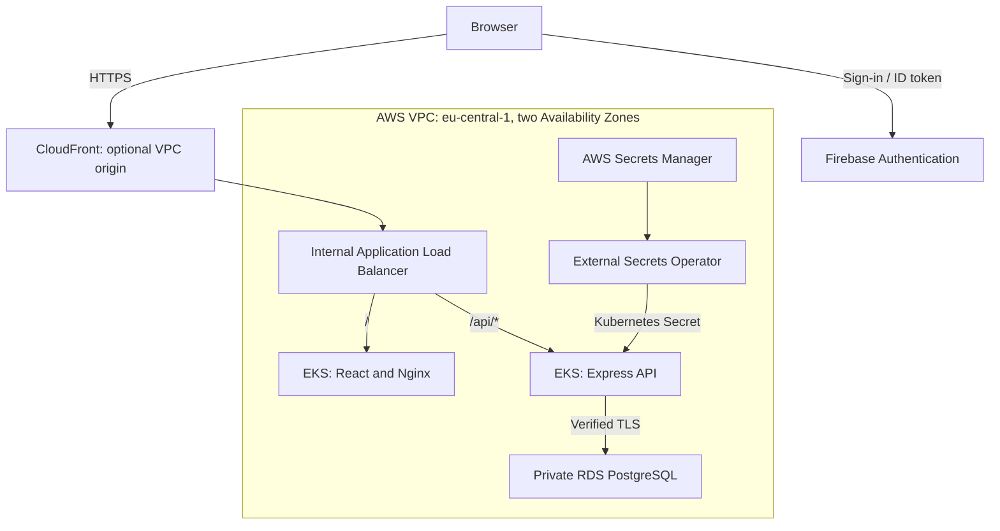

# AWS EKS Terraform Platform

[](https://github.com/Atis18/aws-eks-terraform-platform/actions/workflows/ci.yml)

A DevOps portfolio project that packages an employee and equipment management application and defines its AWS platform as code. React and Express run in Docker containers; Terraform provisions EKS, networking, ECR and a private PostgreSQL RDS database.

The focus is the path from a reproducible local stack to an AWS deployment: container builds, Kubernetes routing, workload identity, secret delivery, health checks and automated validation.

**[Local setup](#run-locally) · [Architecture](docs/ARCHITECTURE.md) · [AWS deployment](docs/DEPLOYMENT.md) · [Testing](docs/TESTING.md) · [Costs](docs/COSTS.md)**

## What the project demonstrates

- A VPC across two Availability Zones with separate public, application and database subnets.
- EKS managed nodes in private subnets, with Cluster Autoscaler and an EBS CSI driver.
- Dedicated EKS Pod Identity associations for the AWS Load Balancer Controller, Cluster Autoscaler and External Secrets Operator.
- Private RDS PostgreSQL with encrypted storage, verified TLS connections and a separate application database user.
- An internal ALB with path-based routing and an optional public HTTPS entry point through a CloudFront VPC origin.
- Immutable ECR image tags, scan-on-push and image retention policies.
- Backend and frontend tests, real PostgreSQL migration tests, manifest checks, Helm rendering and Docker smoke checks in GitHub Actions.

The application supports Firebase sign-in, employee and equipment CRUD, employee search, sorting and equipment assignment.

## Architecture



The browser sends its Firebase ID token with API requests; the backend verifies it. Terraform owns the AWS foundation, Helm installs the controllers, and Kubernetes manifests define the application. See [architecture decisions and the database model](docs/ARCHITECTURE.md).

## Technology stack

| Layer | Technologies |
| --- | --- |
| Infrastructure | Terraform, AWS VPC, EKS, EC2 managed node groups, RDS PostgreSQL 17 |
| Traffic and images | CloudFront VPC origins, ALB, ECR, Docker, Nginx |
| Kubernetes operations | Helm, Cluster Autoscaler, EBS CSI, EKS Pod Identity, External Secrets Operator |
| Application | React 18, Vite, Express 5, Node.js 22, Firebase Authentication |
| Quality checks | Node test runner, Vitest, React Testing Library, PostgreSQL integration tests, Python unittest, GitHub Actions |

EKS is configured for Kubernetes **1.36** and the autoscaler image for **v1.36.1**. The autoscaler service account is deliberately configured under `rbac.serviceAccount` so it matches the Terraform Pod Identity association.

## Run locally

No IDE or AWS account is required. You need **Git, Docker with Compose v2**, and a **Firebase project with a registered web app** for interactive sign-in.

1. In Firebase Console, register a web app, enable **Authentication → Email/Password**, and add **localhost** to Authentication's authorized domains. Google sign-in is optional and requires enabling the Google provider.
2. Clone the repository and create the local configuration:

   ```bash
   git clone https://github.com/Atis18/aws-eks-terraform-platform.git
   cd aws-eks-terraform-platform
   cp .env.sample .env
   ```

   On PowerShell, use `Copy-Item .env.sample .env`.
3. Fill in the `VITE_FB_*` web-app settings in `.env`. The frontend and backend use the same `VITE_FB_projectId`. These settings are public client configuration; never put a Firebase Admin SDK private key in them.
4. Build and start the complete stack:

   ```bash
   docker compose up --build --wait
   ```

5. Open **http://localhost:8080**, create an account and sign in. Add equipment, then create an employee and assign the equipment.

| Endpoint | Purpose |
| --- | --- |
| `http://localhost:8080` | React frontend; Nginx proxies `/api/*` to the backend |
| `http://localhost:3001/api/health` | Backend liveness |
| `http://localhost:3001/api/ready` | Backend database connectivity |
| `localhost:5432` | Local PostgreSQL, bound to the loopback interface |

Compose initializes the schema from the SQL migrations on the **first start of a new database volume**. Changing the SQL files does not update an existing volume automatically. Firebase settings are compiled into the frontend, so rebuild after changing them.

Check connectivity without signing in:

```bash
bash scripts/smoke-test.sh
docker compose logs --tail=50
```

Stop the stack with `docker compose down`; the database volume is retained. To deliberately delete local data and start from a clean schema, use `docker compose down --volumes`.

## Automated checks

Node.js 22 is used in CI. The application suites do not require AWS credentials or live Firebase credentials.

```bash
npm --prefix apps/backend ci
npm --prefix apps/backend run test:coverage

npm --prefix apps/frontend ci
npm --prefix apps/frontend run lint
npm --prefix apps/frontend run test:coverage
npm --prefix apps/frontend run build
```

The backend enforces a minimum **80% line coverage** for its unit and HTTP tests. CI also runs the SQL migrations against PostgreSQL 17, validates Terraform, checks references between Kubernetes resources, renders the pinned Helm charts and builds the full Docker stack. See [test commands, scope and limitations](docs/TESTING.md).

## Deploy to AWS

Follow the [deployment and teardown runbook](docs/DEPLOYMENT.md). Deployment has two stages: first the AWS foundation and Kubernetes application, then the CloudFront VPC origin once the internal ALB exists.

Terraform uses an S3 remote backend with native state locking. Its bucket must exist before deployment and is provisioned separately from the application infrastructure. Retain it after demo teardown; see [state backend setup](docs/STATE-BACKEND.md).

**AWS resources incur charges while provisioned.** Review [the dated cost estimate and its exclusions](docs/COSTS.md) before applying Terraform. CI performs validation and local container tests; it does not deploy to AWS.

## Repository guide

| Path | Contents |
| --- | --- |
| `terraform/` | Network, EKS, controller IAM, RDS, ECR and optional CloudFront |
| `helm/` | Controller values and pinned chart versions |
| `k8s/` | Deployments, Services, ConfigMap, secret references and Ingress |
| `apps/backend/` | Express API, SQL migrations, Dockerfile and tests |
| `apps/frontend/` | React application, Nginx image and tests |
| `compose.yaml`, `docker/` | Complete local stack and local API proxy |
| `scripts/`, `tests/` | Add-on rendering/install commands, smoke and platform checks |
| `docs/` | Architecture, deployment, testing, RDS initialization and costs |