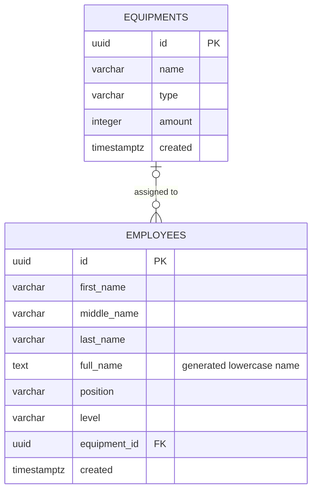

# Architecture and decisions

## Responsibility boundaries

| Tool | Owns |
| --- | --- |
| Terraform | VPC, subnets, NAT Gateways, EKS, managed nodes, EBS CSI, IAM/Pod Identity associations, RDS, ECR, Secrets Manager secret container and optional CloudFront |
| Helm | AWS Load Balancer Controller, Cluster Autoscaler, External Secrets Operator |
| Kubernetes manifests | Frontend/backend Deployments and Services, ConfigMap, SecretStore, ExternalSecret, Ingress |
| Database initialization | SQL schema, restricted application role and its password |
| GitHub Actions | Validation, tests, production builds and disposable local containers |

Terraform creates the application credential secret **without a value**. An operator sets the application password in PostgreSQL and stores the matching value in Secrets Manager. External Secrets copies only the application credentials into Kubernetes. The application does not receive the RDS administrator password.

## Network and request path

The default VPC is `10.20.0.0/16` in `eu-central-1`. Each of two Availability Zones has a public `/24`, private application `/24` and database `/24` subnet. One NAT Gateway per AZ provides outbound access for private nodes.

EKS nodes have no application-facing public ingress. The Kubernetes Ingress creates an **internal** ALB in the private subnets. CloudFront's optional VPC origin gives the application a public HTTPS URL. Traffic from CloudFront to the ALB currently uses HTTP within the private origin path; this is not an end-to-end TLS design.

The ALB sends `/api` requests to the backend on port 3000 and other paths to the frontend on port 80. CloudFront disables caching for both behaviors and forwards API authorization headers using its origin request policy. Nginx serves the React SPA and handles browser-route reloads.

In local Compose, a separate Nginx configuration proxies `/api/*` to the backend. The AWS frontend image relies on ALB routing instead.

The EKS API has private access plus public access restricted to one administrator IPv4 `/32`. The public administrator address can be specified or detected during Terraform planning. A changed home/VPN IP requires updating that setting.

## Identity and credentials

| Workload | AWS access mechanism |
| --- | --- |
| AWS Load Balancer Controller | Dedicated Pod Identity association and controller policy |
| Cluster Autoscaler | Dedicated Pod Identity association and autoscaler policy |
| External Secrets Operator | Pod Identity; permission to read the specific application database secret |
| EBS CSI driver | Pod Identity association configured on the EKS add-on |
| Express application | PostgreSQL application username/password from a Kubernetes Secret |

Controller service account names must match their Terraform associations. The autoscaler chart expects `rbac.serviceAccount.name`; the other controller charts use `serviceAccount.name`. CI checks both the input values and the effective rendered Deployments.

The browser signs in with Firebase and attaches an ID token to API calls. The API verifies the token and rejects missing or invalid tokens. All authenticated users currently access the same employee/equipment dataset; application roles and per-user ownership are not implemented.

Firebase web configuration is public build-time configuration. Firebase Admin private keys, database passwords, Terraform state and local environment files must stay outside Git.

## Data model

An employee can have zero or one equipment record; multiple employees can reference the same record. Deleting equipment sets the employee reference to `NULL`. The schema checks non-negative equipment stock and non-empty required employee fields. Assignment does not decrement stock or implement inventory reservation.

RDS uses PostgreSQL 17, Multi-AZ, encrypted gp3 storage and no public access. Its security group allows PostgreSQL from the EKS node security group. The application enables certificate verification with the bundled Frankfurt RDS CA. RDS IAM database authentication is enabled in infrastructure, but the application currently uses password authentication.

## Availability and scaling

- The managed node group uses On-Demand `m6i.large` instances with minimum/desired/maximum sizes of 2/2/4.
- Frontend and backend each request two replicas. Explicit topology spread and application PodDisruptionBudgets are future work, so replica count alone does not prove distribution across AZs.
- Cluster Autoscaler changes node capacity for scheduling demand; a Horizontal Pod Autoscaler is not configured.
- Backend liveness checks the process; readiness checks PostgreSQL with `SELECT 1`. Readiness does not certify the complete schema or Firebase configuration.
- RDS has a standby in a second AZ. No failover timing or availability SLA has been measured.

## Deliberate portfolio tradeoffs

Two NAT Gateways, two baseline worker nodes and Multi-AZ RDS demonstrate a multi-AZ design, with a higher idle cost than a minimal learning cluster. See [cost assumptions](COSTS.md).

CloudFront is a second Terraform stage because Kubernetes creates its ALB origin. Terraform does not install Helm releases or apply application manifests. The runbook makes that ordering explicit.

Terraform stores state in S3 and uses native S3 lockfiles. The bucket is provisioned separately from the application infrastructure and retained after demo teardown. Bucket versioning and backend access must be configured before deployment; see [state backend setup](STATE-BACKEND.md). Backups, deletion protection, observability, workload hardening and tested recovery procedures remain improvements before treating this as a production platform.

## References

- [AWS: Cluster Autoscaler version compatibility](https://aws.github.io/aws-eks-best-practices/cluster-autoscaling/)
- [AWS: EKS Pod Identity](https://docs.aws.amazon.com/eks/latest/userguide/pod-identities.html)
- [AWS: CloudFront VPC origin prerequisites and security groups](https://docs.aws.amazon.com/AmazonCloudFront/latest/DeveloperGuide/private-content-vpc-origins.html)
- [Upstream autoscaler chart values](https://github.com/kubernetes/autoscaler/blob/master/cluster-autoscaler/charts/cluster-autoscaler/values.yaml)
